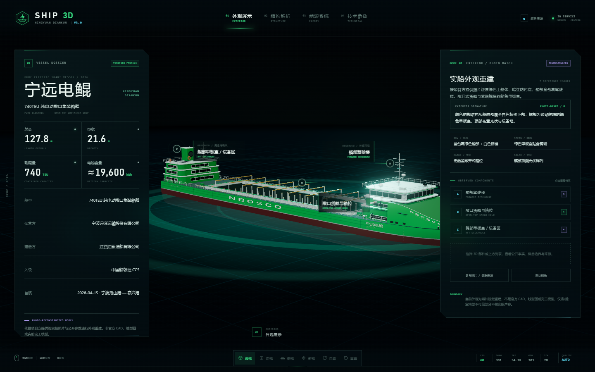
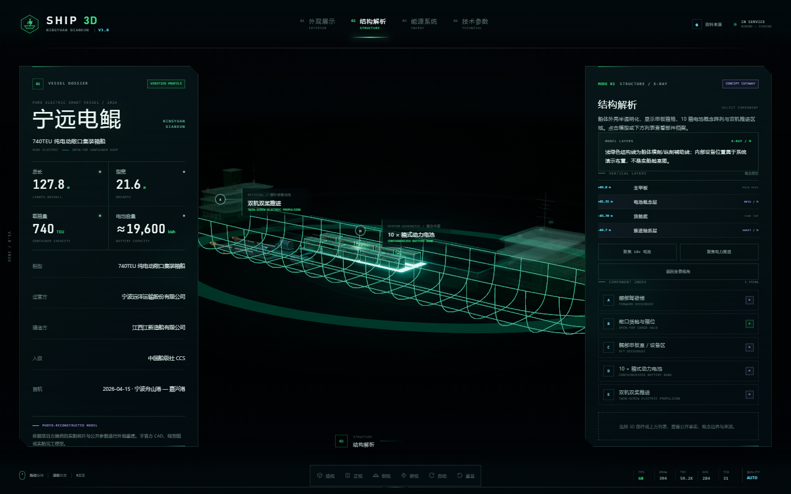
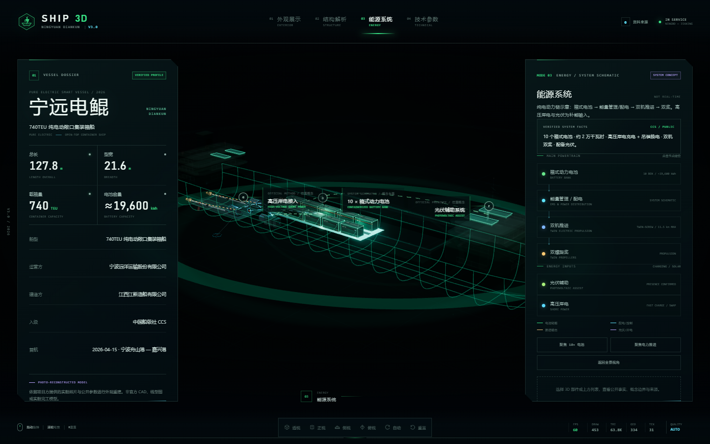
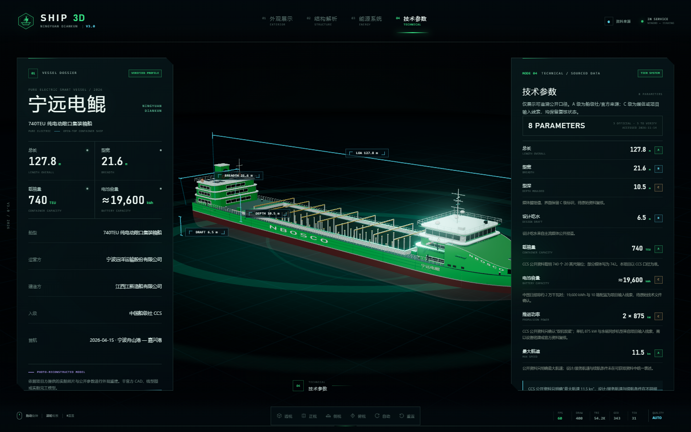
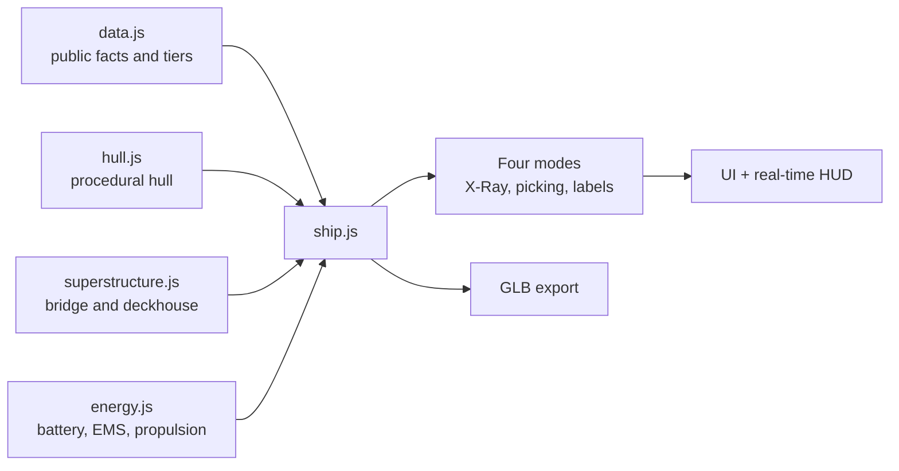
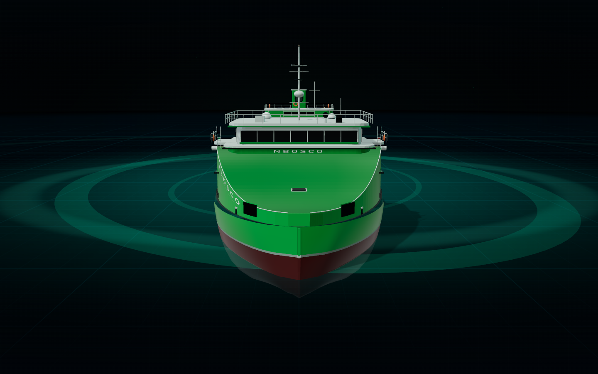
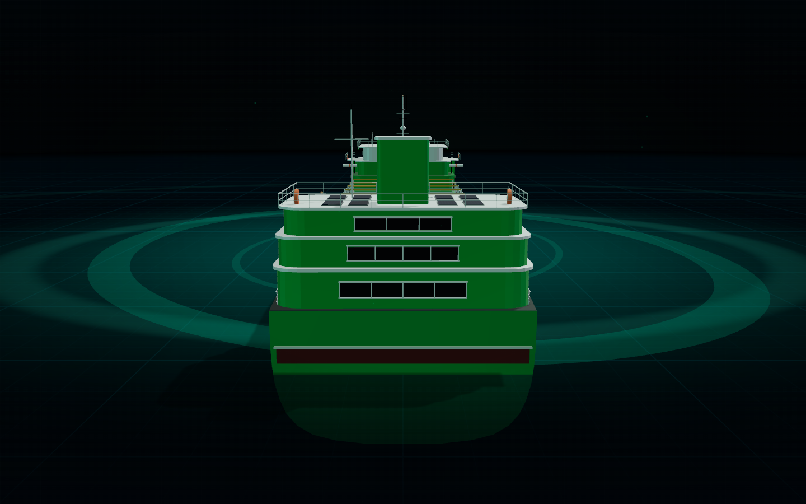

# SHIP 3D

**An interactive ship digital twin built through an AI-agent workflow.**

SHIP 3D is a browser-based, photo-referenced 3D showcase of **宁远电鲲 / NINGYUAN DIANKUN**, a 740 TEU battery-powered open-top container ship. The vessel is generated procedurally at 1:1 metre scale with Three.js and explored through four interactive modes: exterior, structure, energy and technical data.

[中文说明](README.zh-CN.md) · [GLB model](models/ningyuan-diankun.glb) · [Performance](docs/PERFORMANCE.md) · [Sources](docs/SOURCES.md)


> [!IMPORTANT]
> This is an **unofficial, non-commercial visual reconstruction**. It is not an official CAD model, general-arrangement drawing or engineering deliverable, and it is not affiliated with or endorsed by the ship owner, builder, class society or media outlets. Internal arrangements and system locations shown in the app are conceptual unless explicitly cited.



## Why this project exists

Most AI-generated 3D demos stop at a hero render. This project treats the agent as a technical collaborator: it has to respect real dimensions, match supplied reference photos, expose real performance numbers, survive automated QA, and export a usable GLB.

The result is not just a model. It is a small, inspectable system:

- a **procedural 1:1 metre-scale ship**, not a billboard or a block assembly;
- **four modes** built around one scene: exterior, structure, energy and technical;
- a **real performance HUD** driven by `renderer.info` and `requestAnimationFrame`;
- an **X-Ray structure view**, clickable components, labels and dimension overlays;
- a **219-mesh, 2.43 MB GLB** exported from the live scene;
- a documented **human-in-the-loop agent workflow**, including the corrections that changed the model.

## What this is — and is not

| It is | It is not |
| --- | --- |
| A photo-referenced, interactive visual reconstruction | Official CAD, lines plan or a construction drawing |
| A Three.js / WebGL case study in procedural modelling | A naval architecture or hydrodynamics tool |
| A demonstration of data provenance and real-time metrics | Live ship telemetry or a battery-management system |
| An agent workflow with human visual review | A claim of fully autonomous ship design |

## The ship

| Public data | Value | Note |
| --- | --- | --- |
| Container capacity | **740 TEU** | CCS public information |
| Length overall | **127.8 m** | CCS public information |
| Beam | **21.6 m** | Public media |
| Depth | **10.5 m** | C-level / to be verified |
| Design draft | **6.5 m** | Public media |
| Propulsion | **Twin screw** | CCS public information |
| Max speed | **11.5 kn** | CCS public information |
| Batteries | **10 box batteries** | CCS public information |
| Charging | **High-voltage shore charging + battery swap** | CCS public information |
| Solar | **PV system** | CCS public information; visible panels on the aft roof |

The model also contains a **2 × 5 battery array in the open cargo hold**. This is a visual concept for legibility — the real battery compartment layout has not been published.

## Four modes

| Mode | What it shows | Interaction |
| --- | --- | --- |
| **01 Exterior** | Green livery, red antifouling, raised full-wrap bow, open-top cargo holds, green aft deckhouse with roof PV | Orbit, zoom, hotspots, component list |
| **02 Structure** | Semi-transparent hull, structural lines, deck layers, cargo hold, conceptual battery array, twin-screw propulsion | Click a 3D part or list item; battery and propulsion close-ups |
| **03 Energy** | Battery → EMS/distribution → twin motors → twin propellers; shore power and PV inputs; animated energy flow | Energy-chain nodes, 3D parts, system notes, focus camera |
| **04 Technical** | Eight public dimensions, A/B/C source tiers, 3D LOA/beam/depth/draft overlays | Source dialog, measurement caveats |

| Structure | Energy | Technical |
|:---:|:---:|:---:|
|  |  |  |

The exterior view at the top of this page is mode 01.

### Controls

- **Drag** to orbit · **Scroll** to zoom · **Double-click empty water** to clear selection
- **1 / 2 / 3 / 4**: perspective / front / side / top
- **R**: reset camera · **Space**: auto-orbit
- **Quality**: `AUTO → HIGH → BALANCED → PERFORMANCE`
- **Battery / propulsion focus**: available in structure and energy modes
- On mobile, use the **Details** drawer and the top mode navigation

## Quick start

### Requirements

- Node.js **20+**
- A modern browser with **WebGL 2** and hardware acceleration (Edge, Chrome, Firefox)
- No backend, no external CDN, no API keys

### Run locally

```bash
npm ci
npm run dev
```

Open **http://127.0.0.1:5174/**.

### Production build

```bash
npm run build
npm run preview
```

Open **http://127.0.0.1:4174/**.

> Do not open `index.html` directly. ES modules, WebGL and the GLB download require a local server.

### Windows convenience scripts

`start.bat` starts the development server; `start-production.bat` builds and previews the production bundle. The npm commands above are the cross-platform path.

## How it was built

The agent worked from public facts, a human-curated reference set and repeated visual review — not from a CAD file.



### Human in the loop

| Phase | Agent | Human |
| --- | --- | --- |
| Reference and data | Organised public claims and source tiers | Supplied reference photos and visual direction |
| Modelling | Procedural hull, superstructure, outfitting, materials | Reviewed proportions and silhouette |
| Interaction | Four modes, X-Ray, picking, labels, energy flow | Set feature priorities |
| Visual QA | Rendered, compared, iterated, re-ran tests | Marked corrections and accepted the final views |
| Release | Benchmarked, exported GLB, documented boundaries | Chose the public positioning and licence |

### Correction log

| Round | Problem | Correction |
| --- | --- | --- |
| 1 | Open forecastle and a protruding bow tip | Removed the bulbous protrusion; built a full-wrap green bow casing |
| 2 | Aft deckhouse was white, set forward, with visible unused stern space | Recoloured green, moved flush to the transom, added roof PV and hose reels |
| 3 | Green wrap sat too low; bow windows were missing | Raised the wrap one deck; added two curved bow windows; sharpened the stem |
| 4 | Aft house still left wide side decks | Widened the house close to the shell, keeping the stepped tiers |

These are **curated engineering notes**, not raw chain-of-thought. The correction loop is the point of the project: the first version was not the final version.

### Final verification views

| Bow: raised wrap, curved windows, sharpened stem | Stern: near-full-width deckhouse |
|:---:|:---:|
|  |  |

## Performance

The HUD reports real values from `renderer.info` and real wall-clock frame time. Nothing is pre-baked.

Test environment: **AMD Radeon RX 580 2048SP · Ryzen 5 2600 · Windows 10 · Edge 157 · 1440 × 900 · DPR 1 · production build**.

| Quality | Avg FPS | Draw calls | Triangles | What changes |
| --- | ---: | ---: | ---: | --- |
| **HIGH** | **59.7** | **391** | **54,202** | Shadows + bloom + full detail |
| **BALANCED** | **59.8** | **365** | **54,202** | Lower shadow sampling; fine livery details reduced |
| **PERFORMANCE** | **60.0** | **235** | **38,286** | Shadows and post-processing off; hull and core structure kept |

- All four modes stay around **59.8 FPS** at HIGH on this machine.
- Quality switching does **not** hide the whole ship, pause animations or fabricate the FPS reading.
- Draw calls include shadow and post-processing passes where enabled.
- Numbers are hardware-specific and are not a guarantee for other devices.

Full method and per-mode samples: **[docs/PERFORMANCE.md](docs/PERFORMANCE.md)**.

## Model

The runtime model is **procedural geometry**, not an image sprite or a simple block assembly. The hull is lofted from sections; materials, deck openings, livery, structural lines and equipment are generated in code.

| Attribute | Value |
| --- | --- |
| File | [`models/ningyuan-diankun.glb`](models/ningyuan-diankun.glb) |
| Size | 2,549,072 bytes (2.43 MiB) |
| Meshes | 219 |
| Instanced meshes | 0 (baked for compatibility) |
| Animations | 0 |
| Coordinates | X bow, Y up, Z starboard; metres; design waterline `y = 0` |
| Bounds | 128.09 × 28.85 × 22.60 m |
| SHA-256 | `F90F86DA7625C45AD2F8002C36C58BE70B552987BFBABA97E9126F822C998919` |

The GLB contains the exterior appearance only. The conceptual energy layer, dimension lines, HTML labels, water and lights are not exported.

Model structure, export method and replacement workflow: **[docs/MODEL.md](docs/MODEL.md)**. File metadata: **[models/README.md](models/README.md)**.

## Data provenance

The project uses four source tiers:

| Tier | Meaning |
| --- | --- |
| **A / Official** | CCS, Xinhua and other official public material |
| **B / Reported** | Mainstream media, not necessarily checked against primary documents |
| **C / To verify** | Media summaries or project-input leads |
| **M / Conceptual** | 3D reconstruction or system diagram; not a real internal arrangement |

Core boundaries:

- CCS public information supports **740 TEU**, **127.8 m LOA**, **twin-screw**, **11.5 kn max speed**, **10 box batteries**, **PV**, and **high-voltage shore charging + battery swap**.
- Beam and draft come from public media. Depth, battery capacity and motor power remain **B/C-level** claims.
- The **10-battery 2 × 5 array in the cargo hold is a concept**, not the real compartment layout.
- Energy flow, EMS cabinet positions, shafting, PV area/connections and shore-power interface positions are **conceptual**.
- Conflicting public figures are preserved rather than smoothed over: **740 vs 742 TEU** and **≈20,000 vs 19,600 kWh**; CCS is preferred where available.
- No live telemetry, real SOC, or real power data is connected.

Third-party reference photographs are **not redistributed** in the public repository. They were used locally for visual reconstruction; source links and observation notes remain in **[docs/SOURCES.md](docs/SOURCES.md)**.

## Project structure

```text
.
├─ index.html                  # app shell, HUD and dialogs
├─ css/style.css               # industrial HUD, modes, responsive layout
├─ js/
│  ├─ main.js                  # startup, modes, picking, render loop, GLB export
│  ├─ scene.js                 # renderer, lights, water, particles, post-processing
│  ├─ hull.js                  # lofted hull, deck, cargo hold, fittings
│  ├─ superstructure.js        # forward bridge, aft deckhouse, mast and equipment
│  ├─ energy.js                # batteries, EMS, motors, propellers, PV, shore power
│  ├─ ship.js                  # assembly, X-Ray materials, picking, dimensions, LOD
│  ├─ controls.js              # camera director, presets, auto-orbit
│  ├─ performance.js           # live stats and adaptive quality
│  ├─ ui.js                    # mode content, component details, source dialog
│  ├─ data.js                  # ship facts, source tiers, component records
│  ├─ materials.js             # materials and procedural textures
│  └─ utils.js                 # geometry / curve / merge helpers
├─ assets/                     # self-authored textures and decals only
├─ models/                     # GLB, manifest and model notes
├─ docs/                       # sources, model, performance and previews
├─ tests/                      # QA, benchmark, captures, GLB verification
├─ scripts/                    # build wrapper and model export
├─ README.zh-CN.md
├─ start.bat
└─ start-production.bat
```

The public distribution is intentionally static: **no backend, no database, no secrets**. `dist/`, `node_modules/`, local caches and third-party reference photos are not part of the source repository.

## Testing

The browser QA suite is local by design: it needs a real GPU, WebGL and a local browser, not a mocked DOM.

```bash
npm run dev          # terminal 1 — dev server on 5174

npm run qa           # component picking, modes, HUD, source dialog, mobile layout
npm run build
npm run preview      # terminal 2 — production preview on 4174
npm run benchmark    # quality profiles and per-mode stats
npm run capture      # documentation screenshots
npm run verify:model # independent GLB load check (dev server)
npm run export:model # re-export GLB from the live scene (production preview)
```

Notes:

- The browser-based scripts are configured for a local **Windows + Microsoft Edge** setup. `SHIP3D_URL` can override the page URL in the scripts that support it; `SHIP3D_BROWSER` can override the browser path where implemented.
- The automated QA covers the four modes, real performance readouts, 3D picking, empty-water selection clearing, the source dialog, camera presets, keyboard controls, auto-orbit, three quality profiles, animation continuity and console errors.
- The test matrix in this repository is **local**; GitHub Actions is intended to build the static Pages artifact only, not to claim browser QA on CI.

## Known limitations

- No official CAD, lines plan or compartment drawings were available; the exterior is a photo-referenced reconstruction.
- Unseen back faces, equipment details and internal structures are plausible completions, not verified geometry.
- Public sources conflict; the project keeps the conflict visible and gives CCS priority.
- Motor supplier, exact motor power and permanent-magnet details remain unverified leads.
- The 10-battery layout, EMS, shafting, PV wiring and shore interface are visual concepts.
- Performance depends on GPU, resolution, driver and browser; the table above is one test machine.
- External source links may change over time.

## Licence and credits

- **Code:** MIT.
- **Original 3D model, documentation and self-rendered images:** CC BY-NC 4.0.
- **Third-party reference photographs, press images, ship names and logos:** not included in these licences; rights remain with their respective owners.
- This is an unofficial, non-commercial case study. It is not affiliated with or endorsed by the ship owner, builder, CCS or any media outlet.

If you are a rights holder and want an asset removed or credited differently, please open an issue in the repository.

Reference photographs are not redistributed. The model and renders are visual reconstructions, not design documents.

## References

- China Classification Society (CCS): <https://www.ccs.org.cn/ccswz//articleDetail?id=202604070331469396>
- Xinhua: <https://www.xinhuanet.com/20260415/bad51c86ab14452d819cbb2c9f48abdd/c.html>
- China Daily: <https://cn.chinadaily.com.cn/a/202608/24/WS6a8bc9fc45ce1aabf7a93497.html>
- Tencent News: <https://news.qq.com/rain/a/20260415A05SS500>
- Toutiao: <https://www.toutiao.com/article/7630314817122845230/>

Detailed source notes, conflicts and parameter-by-parameter provenance: **[docs/SOURCES.md](docs/SOURCES.md)**. The technical appendices are currently written in Chinese; this README provides the English summary.

---

**SHIP 3D V3.0** · NINGYUAN DIANKUN visual reconstruction · 2026  
Built with Three.js and Vite. Not an official ship document.

[中文说明](README.zh-CN.md)
# ship3d-showcase-agent-three.js

