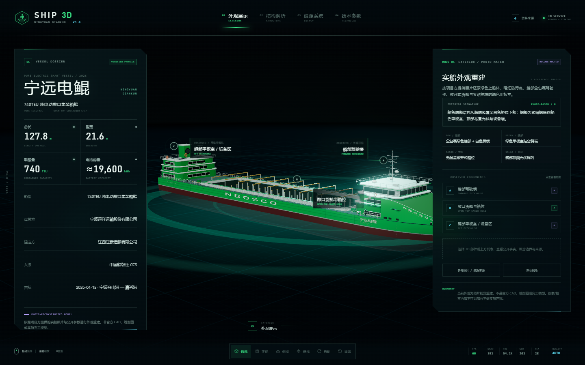
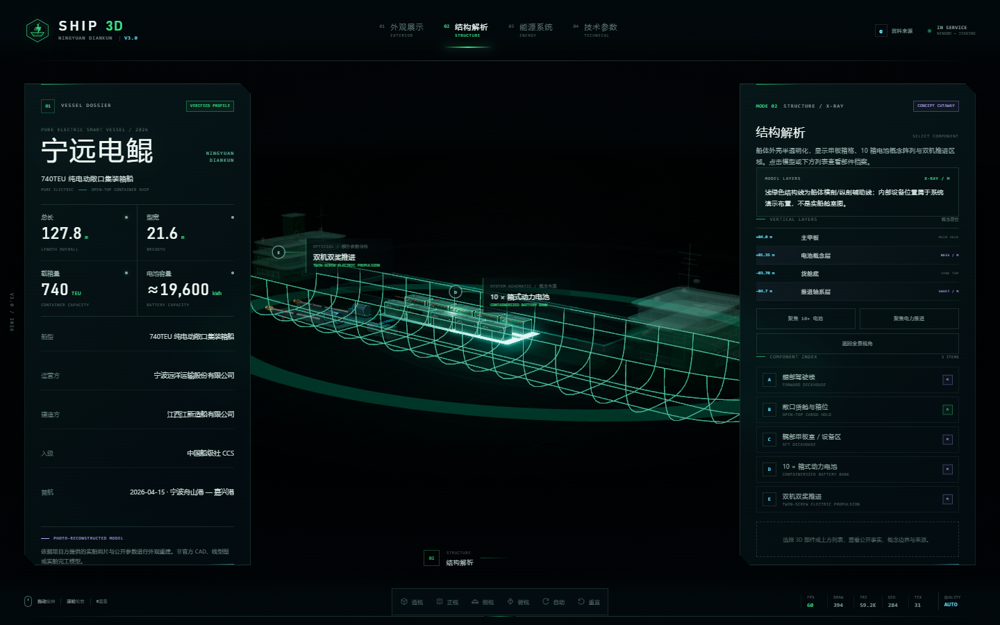
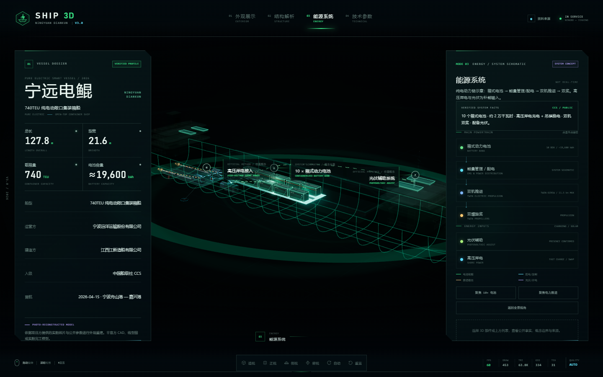
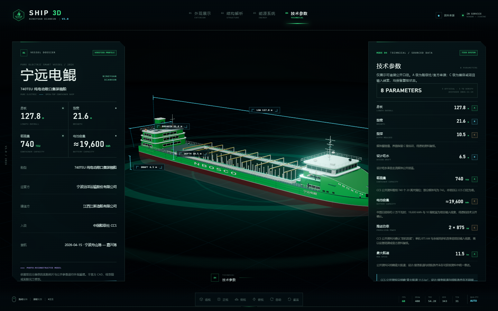
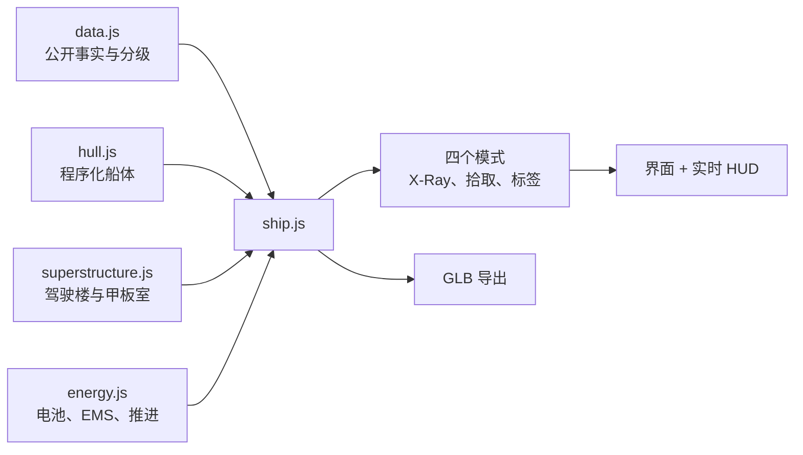
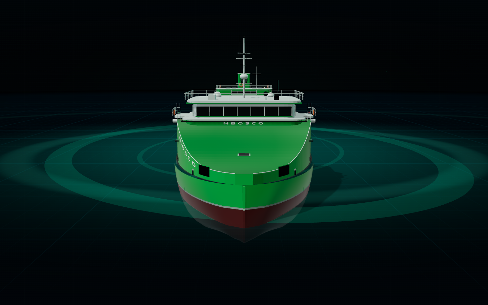
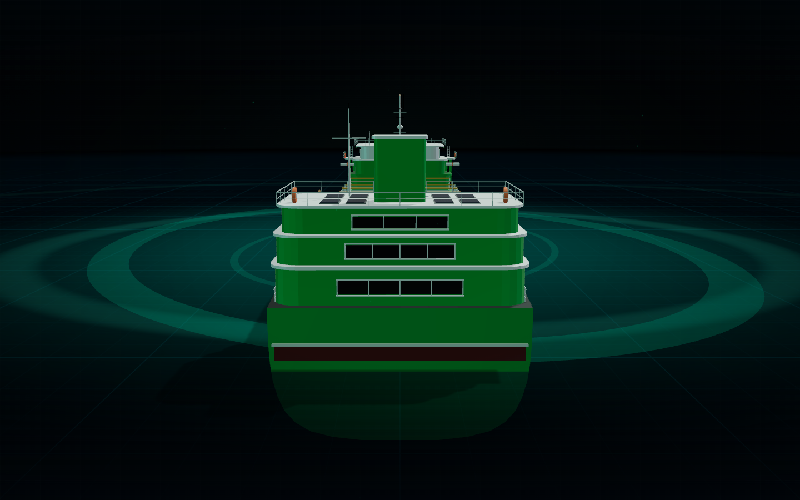

# SHIP 3D

**用 AI Agent 构建可交互船舶数字样机**

SHIP 3D 是 **宁远电鲲 / NINGYUAN DIANKUN** 的浏览器三维展示项目：一艘 740 TEU 纯电动敞口集装箱船，使用 Three.js 以 1:1 米制程序化方式重建，并提供外观展示、结构解析、能源系统、技术参数四个模式。

[English README](README.md) · [GLB 模型](models/ningyuan-diankun.glb) · [性能报告](docs/PERFORMANCE.md) · [来源说明](docs/SOURCES.md)


> [!IMPORTANT]
> 本项目是**非官方、非商业的视觉重建**，不是官方 CAD、总布置图或工程交付物，与船东、船厂、中国船级社及媒体机构无隶属或背书关系。除明确引用的公开参数外，模型中的内部布置和系统位置均为概念示意。



## 项目定位

大多数 AI 生成的三维演示停在“出一张好看的图”。这个项目把 agent 当作技术协作者：它需要遵守真实主尺度、匹配项目方参考照片、暴露真实性能读数、通过自动 QA，并导出可用的 GLB。

因此，这里不只是一个船模，而是一套可以检查的小型系统：

- **1:1 米制程序化船体**，不是图片贴片或简单方块拼装；
- **四个模式**共用一套场景：外观 / 结构 / 能源 / 技术参数；
- **真实性能 HUD**，数据来自 `renderer.info` 和 `requestAnimationFrame`；
- **X-Ray 结构视图**、可点击部件、标签和尺寸线；
- **219 个网格、2.43 MB 的 GLB**，从实时场景导出；
- 一份可追溯的 **human-in-the-loop agent 工作流**，包括模型被修改的几轮关键修正。

## 这是什么，不是什么

| 是 | 不是 |
| --- | --- |
| 基于照片和公开资料的交互式视觉重建 | 官方 CAD、线型图或建造图 |
| Three.js / WebGL 程序化建模案例 | 船舶设计、流体或结构计算工具 |
| 数据分级和真实性能监控的演示 | 实船遥测或电池管理系统 |
| 有真人视觉审核的 agent 工作流 | “全自动设计船舶”的宣称 |

## 船舶公开参数

| 参数 | 数值 | 口径 |
| --- | --- | --- |
| 箱位 | **740 TEU** | CCS 公开资料 |
| 总长 | **127.8 m** | CCS 公开资料 |
| 型宽 | **21.6 m** | 公开媒体 |
| 型深 | **10.5 m** | C 级 / 待复核 |
| 设计吃水 | **6.5 m** | 公开媒体 |
| 推进 | **双机双桨** | CCS 公开资料 |
| 最大航速 | **11.5 kn** | CCS 公开资料 |
| 电池 | **10 个箱式电池** | CCS 公开资料 |
| 补能 | **高压岸电 + 箱式电池换电** | CCS 公开资料 |
| 光伏 | **光伏系统** | CCS 公开资料；艉部屋顶可见光伏板 |

模型货舱内的 **2 × 5 共 10 箱电池阵列是便于展示的概念布置**，不是已公开的实船电池舱位置。

## 四个模式

| 模式 | 内容 | 交互 |
| --- | --- | --- |
| **01 外观展示** | 绿色涂装、暗红防污底、抬高并全包裹的艏部、敞口货舱、紧贴艉端的绿色甲板室与屋顶光伏 | 旋转、缩放、热点、部件列表 |
| **02 结构解析** | 半透明船体、结构线、甲板与货舱、概念电池阵列、双机双桨 | 点击 3D 部件或列表；电池/推进特写 |
| **03 能源系统** | 电池 → EMS/配电 → 双电机 → 双桨；岸电与光伏输入；动态能量流 | 能源链节点、3D 部件、系统说明、聚焦镜头 |
| **04 技术参数** | 8 项公开参数、A/B/C 来源等级、三维总长/型宽/型深/吃水标注 | 来源弹窗、参数口径说明 |

| 结构解析 | 能源系统 | 技术参数 |
|:---:|:---:|:---:|
|  |  |  |

外观模式见页面顶部大图。

### 操作

- **拖动**旋转，**滚轮**缩放，**双击空水域**清除选择；
- **1 / 2 / 3 / 4**：透视 / 正视 / 侧视 / 俯视；
- **R** 重置相机，**Space** 自动环视；
- 底部 `QUALITY` 循环 `AUTO → HIGH → BALANCED → PERFORMANCE`；
- 结构和能源模式支持 **电池 / 电力推进** 聚焦；
- 移动端使用右上角详情抽屉和顶部模式导航。

## 快速开始

环境：**Node.js 20+**，支持 WebGL 2 的现代浏览器（Edge / Chrome / Firefox），无需后端、CDN 或 API Key。

```bash
npm ci
npm run dev
```

打开 **http://127.0.0.1:5174/**。

生产构建：

```bash
npm run build
npm run preview
```

打开 **http://127.0.0.1:4174/**。

> 不要直接双击 `index.html`。ES Module、WebGL 和 GLB 下载都需要通过本地服务器访问。

Windows 也可以双击 `start.bat`（开发）或 `start-production.bat`（构建 + 生产预览）。

## Agent 是怎么工作的

Agent 没有 CAD 文件。它从公开事实、项目方参考照片和反复的视觉审核出发，逐步补齐船体、上层建筑、材质、交互和测试。



### 人和 agent 的分工

| 阶段 | Agent | 人 |
| --- | --- | --- |
| 资料 | 整理公开参数、来源等级和冲突 | 提供参考照片和视觉方向 |
| 建模 | 程序化船体、上层建筑、舾装和材质 | 审核比例与轮廓 |
| 交互 | 四模式、X-Ray、拾取、标签、能量流 | 确定功能优先级 |
| 视觉 QA | 渲染、对照、迭代、重跑测试 | 标注修改并做最终验收 |
| 发布 | 性能测试、GLB 导出、边界文档 | 决定公开定位和授权 |

### 修正记录

| 轮次 | 问题 | 修正 |
| --- | --- | --- |
| 1 | 前甲板开放，艏部有突出体 | 移除突出球鼻，建立绿色全包裹艏部 |
| 2 | 艉部甲板室为白色、位置偏前、艉端有空余 | 改为绿色，贴合艉端，补屋顶光伏和红色卷盘 |
| 3 | 绿色包裹偏低，艏部缺少窗 | 抬高一层，增加两扇弧面窗，艏柱竖向收尖 |
| 4 | 艉部两侧仍留有明显侧甲板 | 甲板室横向加宽至接近外板，保留阶梯层次 |

这些是**整理后的工程记录**，不是原始思维链。第一版不是最终版，修正过程本身就是项目的一部分。

### 最终核对视图

| 艏部：抬高的包裹、弧面双窗、竖向艏柱 | 艉部：接近全宽的绿色甲板室 |
|:---:|:---:|
|  |  |

## 性能

HUD 中的数值来自真实渲染统计和墙钟帧时间，不预置、不伪造。

测试环境：**AMD Radeon RX 580 2048SP · Ryzen 5 2600 · Windows 10 · Edge 157 · 1440 × 900 · DPR 1 · 生产构建**。

| 画质 | 平均 FPS | Draw Calls | Triangles | 说明 |
| --- | ---: | ---: | ---: | --- |
| **HIGH** | **59.7** | **391** | **54,202** | 阴影 + Bloom + 全细节 |
| **BALANCED** | **59.8** | **365** | **54,202** | 较低阴影采样，减少细漆线 |
| **PERFORMANCE** | **60.0** | **235** | **38,286** | 关闭阴影/后处理，保留船体与核心结构 |

- 四模式在 HIGH 下平均约 **59.8 FPS**；
- 画质切换只调整采样、阴影、后处理和少量非关键细节，**不隐藏整船、不暂停动画、不虚报 FPS**；
- 性能与显卡、分辨率、驱动和浏览器有关，不代表所有设备。

完整方法、逐模式采样和限制见 **[docs/PERFORMANCE.md](docs/PERFORMANCE.md)**。

## 模型

运行时模型是程序化几何，不是图片贴片或简单方块拼装。船体由放样截面生成，材质、甲板开孔、涂装、结构线和设备均由代码构建。

| 属性 | 数值 |
| --- | --- |
| 文件 | [`models/ningyuan-diankun.glb`](models/ningyuan-diankun.glb) |
| 大小 | 2,549,072 bytes（2.43 MiB） |
| 网格数 | 219 |
| InstancedMesh | 0（导出时已烘焙） |
| 动画 | 0 |
| 坐标 | X 艏向，Y 向上，Z 右舷；米制；设计水线 `y = 0` |
| 包围盒 | 128.09 × 28.85 × 22.60 m |
| SHA-256 | `F90F86DA7625C45AD2F8002C36C58BE70B552987BFBABA97E9126F822C998919` |

GLB 只包含外观结构；概念能源层、尺寸线、HTML 标签、水面和灯光不导出。

模型结构、导出方法和替换流程见 **[docs/MODEL.md](docs/MODEL.md)**；文件元数据见 **[models/README.md](models/README.md)**。

## 数据与边界

| 等级 | 含义 |
| --- | --- |
| **A / 官方公开** | 中国船级社 CCS、新华社等 |
| **B / 公开报道** | 主流媒体，未逐项回到原始文件 |
| **C / 待复核** | 媒体整理或项目输入线索 |
| **M / 概念重建** | 三维重建或系统原理示意，不代表实船内部布置 |

核心边界：

- CCS 公开资料支持 **740 TEU、127.8 m 总长、双机双桨、最大 11.5 kn、10 个箱式电池、光伏、高压岸电 + 换电**；
- 型宽和吃水来自公开媒体；型深、电池容量、单机功率保留 B/C 级，不写成绝对事实；
- **10 箱电池的 2 × 5 阵列是概念布置**，实船电池舱位置未公开；
- 能源流、EMS 柜位、轴系、光伏面积/接线、岸电接口位置均为概念示意；
- 保留公开口径冲突：**740 vs 742 TEU**、**约 2 万 vs 19,600 kWh**，优先采用 CCS；
- 不接入实船遥测，不展示真实 SOC 或功率。

第三方参考照片**不随公开仓库分发**，仅用于本地视觉重建；来源链接和观察记录见 **[docs/SOURCES.md](docs/SOURCES.md)**。

## 目录结构

```text
.
├─ index.html                  # 应用外壳、HUD、对话框
├─ css/style.css               # 工业 HUD、模式与响应式布局
├─ js/
│  ├─ main.js                  # 启动、模式、拾取、渲染循环、GLB 导出
│  ├─ scene.js                 # 渲染器、灯光、水面、后处理
│  ├─ hull.js                  # 放样船体、甲板、货舱、舾装
│  ├─ superstructure.js        # 艏部桥楼、艉部甲板室、桅杆与设备
│  ├─ energy.js                # 电池、EMS、电机、桨、光伏、岸电
│  ├─ ship.js                  # 总装、X-Ray、拾取、尺寸线、LOD
│  ├─ controls.js              # 相机导演、预设、自动环视
│  ├─ performance.js           # 实时统计与自适应质量
│  ├─ ui.js                    # 模式内容、部件详情、来源弹窗
│  ├─ data.js                  # 船舶数据、来源等级、部件档案
│  ├─ materials.js             # 材质与程序化贴图
│  └─ utils.js                 # 几何、曲线、合并工具
├─ assets/                     # 仅保留自制纹理与贴花
├─ models/                     # GLB、manifest 与模型说明
├─ docs/                       # 来源、模型、性能与预览图
├─ tests/                      # QA、性能基准、截图、GLB 验证
├─ scripts/                    # 构建包装器与模型导出
├─ README.zh-CN.md
├─ start.bat
└─ start-production.bat
```

公开分发是纯静态的：没有后端、数据库或密钥。`dist/`、`node_modules/`、本地缓存和第三方参考照片不进入源码仓库。

## 测试

浏览器 QA 是本地测试，因为它需要真实 GPU、WebGL 和本地浏览器，而不是模拟 DOM。

```bash
npm run dev          # 终端 1：开发服务器 5174

npm run qa           # 四模式、拾取、HUD、来源弹窗、移动端
npm run build
npm run preview      # 终端 2：生产预览 4174
npm run benchmark    # 三档画质与四模式性能
npm run capture      # 文档截图
npm run verify:model # GLB 独立加载验证（开发服务器）
npm run export:model # 从实时场景重新导出 GLB（生产预览）
```

说明：

- 浏览器脚本默认按 **Windows + 本机 Microsoft Edge** 配置；支持覆盖页面地址的脚本可用 `SHIP3D_URL`，部分脚本支持 `SHIP3D_BROWSER`。
- QA 覆盖四模式、真实性能读数、3D 拾取、空水域清除选择、来源弹窗、相机预设、键盘、自动环视、三档画质、动画连续性和控制台错误。
- 本仓库的浏览器测试是**本地测试**；GitHub Actions 只用于构建静态 Pages 产物，不在 CI 中宣称浏览器 QA 通过。

## 已知边界

- 没有官方 CAD、线型图或舱室图；外观是照片参照重建。
- 照片未覆盖的背面、设备细节和内部结构是合理补全，不是已核实几何。
- 公开资料存在冲突；项目保留冲突并优先 CCS。
- 电机供应商、精确功率和永磁机型仍是待复核线索。
- 电池排布、EMS、轴系、光伏接线和岸电接口是视觉概念。
- 性能取决于 GPU、分辨率、驱动和浏览器；上表只代表测试机。
- 外链可能随时间失效。

## 授权与致谢

- **代码**：MIT。
- **原始三维模型、文档、自制渲染图**：CC BY-NC 4.0。
- **第三方参考照片、新闻图片、船名与标识**：不包含在上述授权中，权利归各自所有者。
- 本项目是非官方、非商业案例，与船东、船厂、中国船级社或媒体无隶属或背书关系。

如果你是权利人并希望删除或调整某素材，请在仓库中提交 issue。

参考照片不随仓库分发；模型与渲染图是视觉重建，不是设计文件。

## 参考来源

- 中国船级社 CCS：<https://www.ccs.org.cn/ccswz//articleDetail?id=202604070331469396>
- 新华网：<https://www.xinhuanet.com/20260415/bad51c86ab14452d819cbb2c9f48abdd/c.html>
- 中国日报网：<https://cn.chinadaily.com.cn/a/202608/24/WS6a8bc9fc45ce1aabf7a93497.html>
- 腾讯新闻：<https://news.qq.com/rain/a/20260415A05SS500>
- 今日头条：<https://www.toutiao.com/article/7630314817122845230/>

逐项参数口径、冲突处理和更多来源见 **[docs/SOURCES.md](docs/SOURCES.md)**。

---

**SHIP 3D V3.0** · 宁远电鲲视觉重建 · 2026  
Three.js + Vite · 非官方船舶文件

[English README](README.md)
